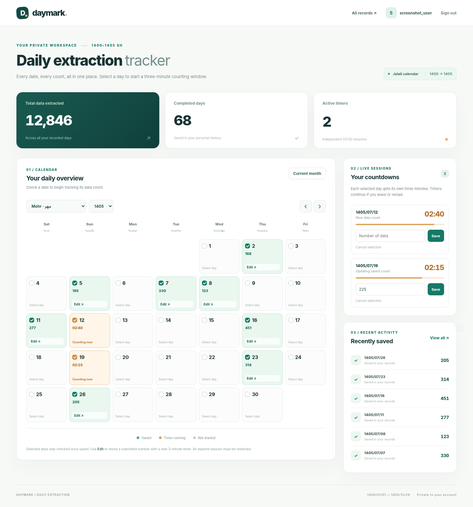
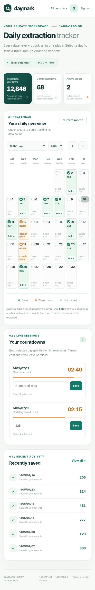
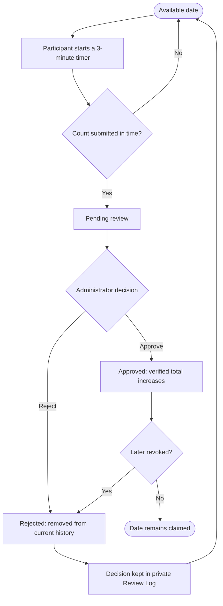
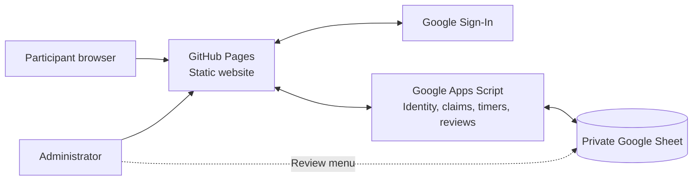

<div align="center">
  

  # Daymark

  **Every day has a number. Make it count.**

  A collaborative daily data-extraction tracker built around the **Jalali (Persian) calendar**,
  three-minute counting sessions, and administrator-verified submissions.

  <p>
    <a href="https://ilyazk.github.io/delta_daymark/"><strong>Open Daymark ↗</strong></a>
    &nbsp;·&nbsp;
    <a href="#-getting-started"><strong>Get started</strong></a>
    &nbsp;·&nbsp;
    <a href="docs/DEPLOYMENT.md"><strong>Deployment guide</strong></a>
  </p>

  <p>
    
    
    
    
  </p>
</div>

---

## ✨ What is Daymark?

**Daymark** gives a team a shared, date-based workflow for recording how many items of data were extracted on a particular day. It replaces scattered spreadsheets and ambiguous progress reports with a visual calendar, individual timed submissions, and a final administrator decision.

It covers **1400/01/01–1405/12/29** on the Persian calendar, with leap-year handling. Participants sign in with their Google accounts; each date can be actively claimed by **only one participant at a time**.

Every submitted count starts as **Pending**. An administrator verifies the work, then either **approves** it toward the participant's verified total or **rejects** it so the date can be reassigned. Rejected claims disappear from participant history, while an internal review log preserves the decision.

## 🖥️ Interface preview

<div align="center">
  <a href="previews/dashboard-layout-reference.png">
    
  </a>
  <br />
  <sub>Desktop dashboard — sample data and layout reference.</sub>
</div>

<details>
  <summary><strong>📱 View the mobile layout</strong></summary>
  <br />
  <div align="center">
    
    <br />
    <sub>Mobile layout — sample data and layout reference.</sub>
  </div>
</details>

> The preview images illustrate the interface layout using sample numbers. They may not show every current v3 review status or administrator control.

## ✅ What you can do

| Participant workspace | Administrator workspace |
| :--- | :--- |
| Sign in with a Google account | Review all submitted date claims |
| Browse all 72 Jalali months (1400–1405) | Approve accurate extraction counts |
| Select available dates on the calendar | Reject unsatisfactory claims with a reason |
| Run several **independent 3-minute timers** | Revoke previously approved claims |
| Submit a count before each timer expires | Reopen rejected dates for other participants |
| Track pending and approved work | Review decisions directly in Google Sheets |
| View personal history and export CSV | Inspect the private review/audit log |

**Designed for shared work:** A reserved, pending, or approved date cannot be independently claimed by another participant. An expired or canceled, unsubmitted session frees the date again.

## 🔄 How the review workflow works



The **three-minute limit applies to entry**, not administrator review. Timer deadlines and claim ownership are enforced by Apps Script rather than trusting the browser's clock.

## 🧩 How it works behind the scenes



- **GitHub Pages** hosts the responsive HTML/CSS/JavaScript frontend; no always-running Python server is needed.
- **Google Sign-In** handles participant authentication. Daymark does **not** collect or store Google passwords.
- **Google Apps Script** verifies identity, coordinates date reservations and deadlines, and enforces administrator permissions.
- **Google Sheets** keeps user accounts, active claims, timers, and the administrator-only review log.

### Spreadsheet structure

| Sheet | Purpose |
| :--- | :--- |
| `Users` | Google identity, joined date, and verified totals |
| `Daily Records` | Active pending/approved claims and recorded counts |
| `Active Timers` | Start and expiration times for independent sessions |
| `Review Log` | Approval/rejection decisions and reasons |

## 🚀 Getting started

To deploy your own copy:

1. **Host the website:** Fork or upload the project to a GitHub repository and enable GitHub Pages from the repository root.
2. **Prepare storage:** Create a private Google Sheet and open **Extensions → Apps Script**.
3. **Install the script:** Copy `apps-script/Code.gs` and its `appsscript.json` manifest into the Apps Script project.
4. **Configure Google Sign-In:** Create a Google OAuth **Web application** client and authorize your GitHub Pages origin (for example, `https://USERNAME.github.io`, without the repository path).
5. **Set Apps Script properties:** Supply `SPREADSHEET_ID`, `GOOGLE_CLIENT_ID`, `FRONTEND_ORIGIN`, and `ADMIN_GOOGLE_EMAIL`. You can additionally set `ADMIN_GOOGLE_SUB`.
6. **Initialize and deploy:** Run `setupSheets()`, then deploy an Apps Script Web App **as you**, with access set to **Anyone** (individual requests are still authenticated by the script).
7. **Connect the frontend:** Add the public Google OAuth Client ID and Apps Script `/exec` URL to `config.js`, then publish.

**→ [Full step-by-step deployment and configuration guide](docs/DEPLOYMENT.md)**

Already using v2? See [UPGRADE_FROM_V2.md](UPGRADE_FROM_V2.md) before migrating existing records.

> **Security:** Keep the Google Sheet private. Never commit spreadsheet edit credentials, Google passwords, OAuth client secrets, or other server-side secrets to GitHub. `config.js` contains *public* client/deployment identifiers only. Google Apps Script Web App URLs are publicly reachable, so the script's per-request authentication and authorization checks are essential.

## 🧪 Run the checks

Node.js 18+ is sufficient for the local test suite:

```bash
npm test
npm run check
```

The local tests simulate Apps Script and Google Sheets. Always also perform a live smoke test of Google Sign-In, simultaneous timers, record submissions, approvals, and rejections after deployment.

## 🗂️ Repository layout

```text
.
├── index.html              # Website and views
├── config.js               # Public Google IDs / deployment URL
├── assets/                 # Calendar, dashboard, auth, admin and history
├── apps-script/            # Google Apps Script backend + manifest
├── previews/               # UI layout previews used above
├── tests/                  # Local integration tests
├── docs/DEPLOYMENT.md      # Setup and deployment guide
└── UPGRADE_FROM_V2.md      # Migration guidance
```

## ℹ️ Scope and limitations

Daymark is aimed at **small teams**. Google Apps Script and Sheets have usage quotas and concurrency limitations; larger deployments may require a dedicated database and backend. The private spreadsheet should be backed up regularly, and the review log is an operational audit trail rather than an immutable compliance record.

---

<div align="center">
  <strong>Daymark</strong> · Every date. Every count. Reviewed.
  <br />
  <a href="https://ilyazk.github.io/delta_daymark/">Launch website</a> · <a href="docs/DEPLOYMENT.md">Deployment guide</a>
</div>
